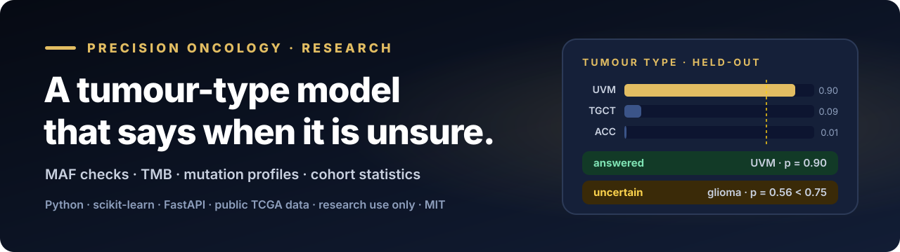
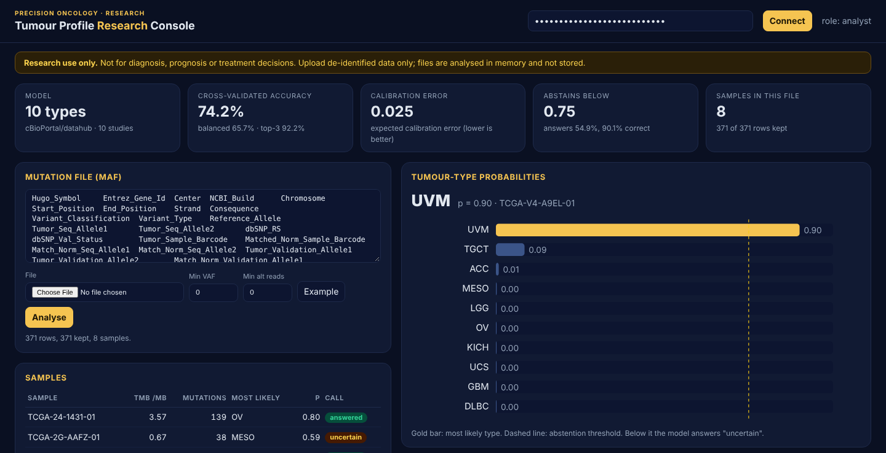
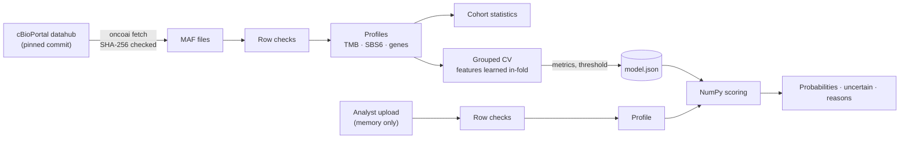

<p align="center"></p>

# Precision Oncology AI Platform

[](https://github.com/md-rubbaite/precision-oncology-ai-platform/actions/workflows/ci.yml)


A research platform for **somatic mutation data**. It reads MAF files and checks every row. For each
tumour it computes **mutational burden** and **substitution profiles**. It puts a sample in the
context of a **public cohort** and estimates **which tumour type** the mutations most resemble, with
probabilities that are **calibrated** and an explicit **"uncertain"** when the evidence is weak.
Everything is evaluated with patient-grouped cross-validation on public TCGA data, and the numbers
are reproducible from one command.

> **Research use only.** Not a medical device. Not for diagnosis, prognosis or treatment decisions.
> No clinical recommendations, no drug matching. See [scope and limits](#limits).

## What it does

| Capability | How |
|---|---|
| **File checks** | Required columns, allele syntax, variant types, duplicates, read-count and allele-frequency filters, pseudonymous sample IDs. Every dropped row is counted with its reason and first line number |
| **Per-tumour profile** | TMB (nonsynonymous mutations per Mb, cBioPortal convention), six substitution classes (SBS6), 96 trinucleotide channels from the `CONTEXT` column, genes and protein changes hit |
| **Cohort context** | Gene recurrence, pairwise co-occurrence / mutual exclusivity (Fisher exact, Benjamini–Hochberg), TMB distribution per tumour type |
| **Tumour-type model** | Multinomial logistic regression on TMB, SBS6, indel share, recurrent genes and recurrent protein changes. Feature space and regularisation learned inside each training fold |
| **Honest evaluation** | 5-fold cross-validation grouped by patient, nested choice of C, baselines (class prior, mutational-process-only), gradient boosting for comparison, calibration error, abstention curve |
| **Says when unsure** | Abstains below a confidence threshold chosen from out-of-fold predictions (target 90 % accuracy on answered samples) |
| **Safe model files** | Models are JSON (classes, features, coefficients) scored with NumPy. No pickle: loading a model cannot run code |
| **Service** | FastAPI with viewer / analyst / admin keys, research console, uploads analysed in memory only, audit trail with file hashes (never content), Prometheus metrics, non-root read-only container |

<p align="center"></p>
<p align="center"><sub>Research console on eight TCGA samples held out from training. Four are answered correctly (OV, UVM); four fall below the threshold and come back as "uncertain" rather than wrong. <a href="assets/console-full.png">Full console</a> with an uncertain case, substitution profile, TMB context and model card.</sub></p>

## Results on public data

Ten TCGA PanCancer Atlas studies (1,870 tumours, 1,863 patients) from the cBioPortal datahub,
pinned to one commit and checked by SHA-256. Patient-grouped 5-fold cross-validation, three seeds.
Full tables: [docs/data/validation.md](docs/data/validation.md).

| Method | Accuracy | Balanced accuracy | Macro-F1 | Top-3 | Log loss | Calibration error (ECE) |
|---|---|---|---|---|---|---|
| **Logistic regression (served)** | **0.745 ± 0.004** | **0.670 ± 0.014** | **0.671 ± 0.010** | **0.917** | **0.867** | **0.027** |
| Gradient boosting, same features (seed 7) | 0.742 | 0.622 | 0.646 | 0.919 | 1.525 | 0.189 |
| Mutational process only (TMB, SBS6, indels) | 0.486 | 0.452 | 0.390 | 0.779 | 1.669 | 0.099 |
| Class prior | 0.273 | 0.100 | 0.043 | 0.703 | 1.933 | — |

- **Abstention:** below p = 0.80 the model says "uncertain". It then answers 49 % of tumours and is right on 91 % of those.
- **Why logistic regression:** boosting matches its accuracy but is badly calibrated (ECE 0.19 vs 0.03) and cannot be stored as plain JSON. A probability that means what it says matters more here than a point of accuracy.
- **Where it struggles:** GBM vs LGG (both brain), UCS predicted as OV (both gynaecological), and low-mutation tumours (ACC, KICH, MESO, TGCT) that carry few informative mutations. UVM is recognised in 90 % of cases (GNAQ/GNA11).
- **Checks against published biology:** TMB matches cBioPortal's value exactly for 67 % of tumours and within two mutations for 97 % (r = 0.9999 on log scale). In LGG, IDH1/TP53/ATRX co-occur and CIC/FUBP1 exclude TP53/ATRX; in UVM, GNAQ and GNA11 are mutually exclusive.

For context: whole-genome classifiers that use passenger mutations reach about 91 % on 24 types
([Jiao et al., 2020](https://doi.org/10.1038/s41467-019-13825-8)). Exome data carries much less of
that signal, which is why this model abstains so often.

## Quick start

```bash
pip install -e ".[dev]"
oncoai demo                                   # offline, synthetic data: read, profile, evaluate, train, predict

oncoai fetch --studies benchmark              # ~225 MB from the cBioPortal datahub, SHA-256 checked
oncoai train --report report.json --boosting  # cross-validation report + model.json
python examples/benchmark.py                  # every number in docs/data/validation.md
oncoai cohort lgg --pairs 10                  # recurrent genes and gene pairs in one study
oncoai predict my_samples.maf --model model.json

export ONCOAI_API_KEYS="viewer:$(openssl rand -hex 16),analyst:$(openssl rand -hex 16),admin:$(openssl rand -hex 16)"
echo "$ONCOAI_API_KEYS"                       # keys for the console
oncoai serve --model model.json               # http://127.0.0.1:8080/dashboard  ·  OpenAPI at /docs
```

Without `--model`, `oncoai serve` trains a small model on synthetic data so the console works
offline; it is labelled as synthetic everywhere. Container: `cp .env.example .env`, set the keys,
`docker compose up -d --build`.

## API

| Method | Path | Role | Purpose |
|---|---|---|---|
| POST | `/v1/analyse` | analyst | MAF as `text/tab-separated-values` (≤ 5 MB, ≤ 25 samples): checks, profiles, probabilities, explanations |
| GET | `/v1/model`, `/v1/cohort` | viewer | Model card (cross-validated metrics, per-type recall, data source), cohort TMB and top genes |
| GET | `/v1/example` | analyst | Example file configured by the operator (`ONCOAI_EXAMPLE_MAF`) |
| POST | `/v1/admin/reload` | admin | Reload the model file |
| GET | `/v1/admin/audit` | admin | Who sent what: role, SHA-256 of the file, samples, outcome |
| GET | `/metrics`, `/healthz`, `/readyz`, `/dashboard` | none | Prometheus metrics, probes, console (the console asks for a key) |

```bash
curl -s -X POST "localhost:8080/v1/analyse?min_vaf=0.05" -H "x-api-key: $ANALYST_KEY" \
  -H 'content-type: text/tab-separated-values' --data-binary @my_samples.maf
```

## Architecture



More detail: [architecture notes](docs/architecture/overview.md) · [model card](docs/model-card.md) · [validation](docs/data/validation.md) · [data governance](docs/data/data-governance.md) · ADRs: [0001 JSON models, no pickle](docs/adr/0001-json-model-format.md) · [0002 grouped CV, features in-fold](docs/adr/0002-grouped-cross-validation.md) · [0003 calibrated linear model with abstention](docs/adr/0003-calibrated-model-with-abstention.md) · [0004 research-use boundary](docs/adr/0004-research-use-boundary.md) · [threat model](docs/security/threat-model.md) · [deployment](docs/deployment.md)

## Limits

- **Research prototype.** Not validated for clinical use, not a medical device, no regulatory clearance. It must not inform any decision about a patient.
- **Ten tumour types.** The benchmark covers the ten PanCancer studies whose files could be fetched when it was built; the other 22 are in the manifest and work with the same commands. A tumour of a type the model has never seen will still get one of the ten labels, usually with low confidence.
- **TCGA primary tumours, exome sequencing.** Metastases, panels, different callers or filtering will shift TMB and features. Results do not transfer without re-validation.
- **No external validation set.** All figures are cross-validated within TCGA; batch and centre effects inside TCGA can flatter them.
- **Pair tests are screening output.** Fisher's test ignores per-tumour mutation rates; use DISCOVER ([Canisius et al., 2016](https://doi.org/10.1186/s13059-016-1114-x)) for conclusions.
- **Explanations describe the model, not the biology.**

## Data and licences

Code: MIT. Data is **not** included: `oncoai fetch` downloads it from the
[cBioPortal datahub](https://github.com/cBioPortal/datahub) (ODbL 1.0; TCGA terms in each study
folder). Mutation calls come from the MC3 project
([Ellrott et al., 2018](https://doi.org/10.1016/j.cels.2018.03.002)). If you publish results
obtained with this platform, cite cBioPortal and TCGA as their terms require. Tests and the demo
use invented data only (tumour types SYNA–SYNE, genes SG001–SG400).

## Project layout

```text
src/oncoai/       maf · features · cohort · model · evaluate · training · data · synthetic · api · cli · demo
tests/            101 unit and integration tests (parsing, SBS96 strand handling, Fisher vs SciPy, leakage, API roles and limits)
examples/         benchmark.py (numbers above) · api_client.py
docs/             architecture, model card, validation, data governance, ADRs, threat model, deployment
```

## Author

Rubbaite T. Hassain. Independent engineering work on public research data.

Architecture, requirements and review by Rubbaite T. Hassain; implementation AI-assisted.

## License

MIT
