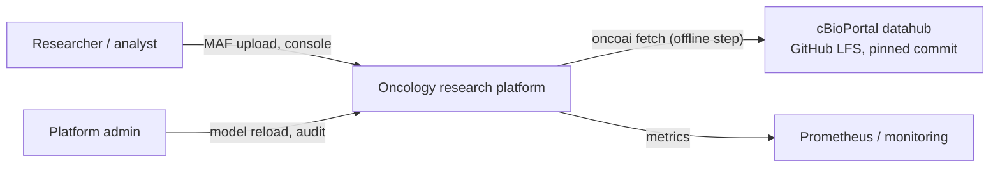

# Architecture notes

## 1. Purpose and boundary

The platform helps a researcher look at somatic mutation data: is the file sound, what does each
tumour's mutation profile look like, how does it compare with a public cohort, and which tumour
type do its mutations most resemble. It is a research tool. It produces no clinical
recommendations and must not inform decisions about a patient (ADR 0004).

## 2. Context (C4 level 1)

There is no connection to clinical systems (EHR, LIMS) and none is planned in this repository.

## 3. Containers and modules (C4 level 2)

| Part | Modules | Runs |
|---|---|---|
| Data acquisition | `data` (manifest, verified download, study loading) | Offline, by an operator |
| Core analysis | `maf` (parsing, row checks), `features` (profiles, feature space), `cohort` (recurrence, pair tests) | CLI and API |
| Modelling | `model` (JSON model, NumPy scoring, explanations), `evaluate` (grouped CV, metrics), `training` (final fit + report) | CLI (training needs scikit-learn) |
| Service | `api` (FastAPI, roles, limits, audit), `dashboard/index.html` | Container |
| Test data | `synthetic` (invented cohorts) | Tests, CI, demo |

The service needs only NumPy, FastAPI and Uvicorn. scikit-learn is needed for training and for
the built-in synthetic demo model.

## 4. Data flow

1. **Fetch.** `oncoai fetch` reads `studies.toml` (commit, file, SHA-256, size from the datahub's
   LFS pointers), downloads over HTTPS to a temporary file, checks size and hash, then moves the
   file into place. A failed check leaves nothing behind.
2. **Read and check.** `read_maf` keeps only the columns it needs and checks each row: required
   fields, allele syntax, variant type, reference ≠ alternate, duplicates, optional read-count and
   allele-frequency thresholds, sample IDs restricted to `[A-Za-z0-9._:-]` (no names or e-mail
   addresses). Rejections are counted by reason with the first line number.
3. **Profile.** Per tumour: counts, TMB = protein-changing mutations ÷ 30 Mb (cBioPortal
   convention), SBS6 and SBS96 (pyrimidine-centred; G/A references are reverse-complemented with
   their flanking bases), genes and protein changes hit.
4. **Learn.** `FeatureSpace.fit` picks genes and recurrent protein changes and the scaling from
   training tumours only. `fit` trains multinomial logistic regression with balanced class weights.
5. **Evaluate.** `cross_validate` repeats step 4 inside every fold of a patient-grouped split,
   chooses C in inner folds, and pools out-of-fold probabilities (ADR 0002).
6. **Serve.** `training.train` fits the final model on all tumours, sets the abstention threshold
   from out-of-fold predictions and writes `model.json` with its evaluation summary (ADR 0001, 0003).
   The API scores uploads with NumPy and returns probabilities, "uncertain" below the threshold, and
   the largest feature contributions.

## 5. Quality attributes

| Attribute | How it is addressed |
|---|---|
| Correctness | 101 tests, including SBS96 strand handling, Fisher and BH against SciPy, NumPy scoring against scikit-learn, metrics against scikit-learn, and a test that fails if any training fold contains a held-out patient |
| Reproducibility | Pinned data commit and checksums; fixed seeds; `examples/benchmark.py` regenerates every published number; CI runs the synthetic demo end to end |
| Security | API keys per role stored as SHA-256; constant-time comparison; body, row and sample limits; no pickle; CSP and no-store headers; non-root read-only container (threat model) |
| Privacy | Uploads processed in memory and never written; audit trail holds hashes and counts, not content; pseudonymous sample IDs enforced |
| Transparency | Model card in every model file and at `/v1/model`; per-prediction explanations; plain-JSON coefficients |
| Performance | Profiling and scoring 25 tumours take milliseconds; a full training run on 1,870 tumours (nested CV, final fit) takes about 20 s on 2 CPU cores |
| Operability | `/healthz`, `/readyz`, Prometheus `/metrics`, JSON access logs with request IDs, model hot-reload for admins |

## 6. Design choices worth knowing

- **Label = study.** TCGA study membership is a reasonable proxy for tumour type but not a
  histological diagnosis; some studies mix subtypes (for example LGG holds astrocytomas and
  oligodendrogliomas).
- **Splice_Region counted as protein-changing.** Chosen because it reproduces cBioPortal's TMB
  best (validation §2). Set `NONSYNONYMOUS` differently if your convention differs.
- **Exome size fixed at 30 Mb.** Correct only for whole-exome data. For panels pass the panel's
  covered size (`oncoai profile --exome-mb`) and re-train; TMB from panels is not comparable
  with TMB from exomes.
- **Pair tests are simple on purpose.** Fisher's test is easy to audit but ignores per-tumour
  mutation rates; it over-calls co-occurrence in hypermutated cohorts. `--max-tmb` removes
  hypermutated tumours as a crude guard; DISCOVER is the method to use for conclusions.

## 7. Path to a real research deployment

What would be needed before using this beyond exploration:
1. External validation on an independent cohort (different centres, sequencing and calling).
2. All 32 PanCancer types, plus a "type not represented" analysis.
3. Panel-aware TMB and features if panel data is expected.
4. Identity provider (OIDC) instead of static keys; per-user audit; retention policy.
5. A data protection impact assessment and ethics approval for any non-public data.
6. If clinical use were ever intended: a quality management system and the applicable medical device
   regulation (for example EU MDR / IVDR) from the start. That is outside this repository.
